  <a href="README.md">English</a> | <strong>Português</strong>

  
  
  

    
    
    
    
  

---

### 🛡️ Filosofia de Engenharia & Pilares Centrais

Desenvolvo software resiliente e auditável com forte ênfase em programação defensiva, aceleração direta por hardware e paradigmas de Confiança Zero (*Zero Trust*).

* **Isolamento Galvânico & Desacoplamento:** Separação estrita entre fronteiras públicas não confiáveis e a lógica interna de execução, mitigando falhas sistêmicas em cascata.
* **Padrões Seguros de Falha (*Fail-Secure* & *Fail-Closed*):** Qualquer anomalia criptográfica, falha de asserção ou validação de fronteira encerra a conexão imediatamente, sem expor rastros da infraestrutura.
* **Desempenho com Acesso Direto ao Hardware:** Eliminação de camadas intermediárias por meio de buffers de cópia zero (*zero-copy*), pontes assíncronas JNI, codificação por GPU (`MediaCodec`), detours em memória de processo (MinHook) e mapeamento direto (`mmap`).
* **Concorrência Determinística:** Pipelines assíncronos orientados a eventos, operações de I/O não bloqueantes e loops de execução com isolamento de threads para garantir vazão previsível.

---

### 🛠️ Matriz de Competências Técnicas

| Domínio | Tecnologias & Ferramental | Padrões Arquiteturais |
| :--- | :--- | :--- |
| **Sistemas & Baixo Nível** | C++20, Detours x86_64 (MinHook), NDK r26, JNI, Kotlin, Engenharia Reversa, POSIX, Mapeamento de Memória (`mmap`) | Buffers Zero-Copy, Injeção em Memória, Sistemas FAT Binários, ABIs Nativas |
| **Backend & Sistemas Distribuídos** | Python (FastAPI, Asyncio), Node.js (ESM), WebSockets (Socket.io), APIs REST | Arquitetura Orientada a Eventos, Políticas ABAC, Portais Fail-Closed, Hubs C2 |
| **Segurança & DevSecOps** | Criptografia Envelope (KMS), AES-256-GCM, Integridade HMAC, Bandit, Ruff, SAST/SCA | Pipelines Zero-Trust, Trilhas de Auditoria (JSONL / SQLite WAL), Sanitização de Dados |
| **Mobile & Frontend** | Android 14 (API 34), React 18, TypeScript, Tailwind CSS, Tauri, Capacitor | Armazenamento com Escopo (SAF), Streaming de Vídeo por Hardware, Sincronização Offline-First |
| **Armazenamento & Dados** | SQLite (Modo WAL), PostgreSQL, Redis, Buffers Circulares em Memória | Registro Atômico ACID, Reconciliação Idempotente de Eventos |

---

### 🚀 Vitrine Pública de Arquitetura

Seleção de projetos de código aberto que demonstram competências práticas de engenharia e arquitetura:

<table width="100%">
  <tr>
    <td width="50%" valign="top">
      <h4><a href="https://github.com/welzim19-star/capivara-emu">🎮 Capivara EMU</a></h4>
      
<em>Motor de Emulação Retrô Multi-Sistemas de Alta Performance para Android.</em>

      <ul>
        <li>C++20, Android NDK r26b, JNI, API Libretro, React 18</li>
        <li>Isolamento galvânico desacoplando a UI TypeScript do pipeline nativo</li>
        <li>Renderização direta no <code>SurfaceView</code> via texturas GLES3 sem cópia</li>
        <li>Engenharia reversa do sistema de arquivos FAT binário do Sega Dreamcast VMU</li>
      </ul>
      

        
        
        
        
      

    </td>
    <td width="50%" valign="top">
      <h4><a href="https://github.com/welzim19-star/zero-ping-mirror">⚡ ZeroPingMirror</a></h4>
      
<em>Motor de Espelhamento de Tela Android e Telemetria em Tempo Real com Latência Ultrabaixa.</em>

      <ul>
        <li>Kotlin 1.9+, Android 14 (API 34), MediaCodec, WebSockets</li>
        <li>Codificação H.264 1080p60 acelerada diretamente por hardware na GPU</li>
        <li>Latência de transmissão sub-frame (11,4 ms) em rede local</li>
        <li>Captura de tela zero-copy via <code>MediaProjection</code> nativo do Android</li>
      </ul>
      

        
        
        
        
      

    </td>
  </tr>
  <tr>
    <td width="50%" valign="top">
      <h4><a href="https://github.com/welzim19-star/mario-physics-hook">🔧 Mario Physics Hook</a></h4>
      
<em>Hook de Memória Nativo em C++ e Ponte de Física para Elden Ring.</em>

      <ul>
        <li>C++20, detours de assembly x86_64 via MinHook, core libsm64</li>
        <li>Trampolins interceptando a memória do Havok Character Controller</li>
        <li>Sincronização de relógio de física multi-taxa (30Hz para 60Hz)</li>
        <li>Injeção dinâmica de malhas de colisão na memória do processo</li>
      </ul>
      

        
        
      

    </td>
    <td width="50%" valign="top">
      <h4><a href="https://github.com/welzim19-star/minebot-c2-engine">🤖 Minebot C2 Engine</a></h4>
      
<em>Agente Autônomo e Orquestrador Command & Control (C2) para Minecraft Java.</em>

      <ul>
        <li>Node.js 18+, Mineflayer, Socket.io, HUD Web Express</li>
        <li>Rotinas de mineração subterrânea anti-freeze e pathfinding 3D A*</li>
        <li>Combate reativo, mitigação de ameaças e seleção de armas</li>
        <li>Autodescoberta sem configuração em LAN via broadcast UDP</li>
      </ul>
      

        
        
      

    </td>
  </tr>
  <tr>
    <td width="50%" valign="top">
      <h4><a href="https://github.com/welzim19-star/archon-v">🛡️ Archon-V</a></h4>
      
<em>Interceptor de Segurança e API Gateway de Alta Disponibilidade para Padrão Bancário.</em>

      <ul>
        <li>FastAPI, Python 3.12+, Uvicorn</li>
        <li>Defesa contra ameaças com Token Bucket O(1) e validador de políticas ABAC</li>
        <li>Criptografia de envelope por locatário (KMS) e trilha imutável SHA-256</li>
        <li>Zero vazamento de stack traces e encerramento estrito em caso de falha</li>
      </ul>
      

        
        
        
      

    </td>
    <td width="50%" valign="top">
      <h4><a href="https://github.com/welzim19-star/bastion-core">🛡️ Bastion-Core</a></h4>
      
<em>Motor Assíncrono de Auditoria de Rede e Registro Criptográfico Imutável.</em>

      <ul>
        <li>Python 3.12+, Concorrência com ThreadPool, Zero-PII Sanitizado</li>
        <li>Ledger imutável encadeado criptograficamente com SHA-256</li>
        <li>Síntese multi-camadas de inteligência de ativos de rede</li>
        <li>Varredura sub-segundo de sub-rede e persistência SQLite WAL</li>
      </ul>
      

        
        
        
        
      

    </td>
  </tr>
  <tr>
    <td width="50%" valign="top">
      <h4><a href="https://github.com/welzim19-star/bedrock-autonomous-agent">⚡ Bedrock Autonomous Agent</a></h4>
      
<em>Agente Nativo UDP e Máquina de Estados para Bedrock Dedicated Server (BDS).</em>

      <ul>
        <li>Node.js, <code>bedrock-protocol</code>, stream binário UDP RakNet</li>
        <li>Negociação dinâmica de versões para servidores BDS 1.26.x</li>
        <li>Lógica de reconexão com backoff exponencial contra flood</li>
        <li>Pesquisa experimental em cinemática autônoma orientada a pacotes</li>
      </ul>
      

        
        
      

    </td>
    <td width="50%" valign="top">
      <h4><a href="https://github.com/welzim19-star/pw-opsdesk-showcase">🏢 Arquitetura PW OpsDesk</a></h4>
      
<em>Especificação Arquitetural de Central Operacional e Despacho de Campo B2B.</em>

      <ul>
        <li>Arquitetura orientada a eventos com Socket.io e Node.js ESM</li>
        <li>Governança RBAC granular (Operador, Supervisor, Administrador)</li>
        <li>Fila SQLite WAL offline-first com reconciliação idempotente</li>
        <li>Trilha de auditoria pericial e biométrica selada por coordenadas e hash de hardware</li>
      </ul>
      

        
        
        
      

    </td>
  </tr>
</table>

---

### 🌐 Governança Corporativa & Sistemas Comerciais

Para explorar as arquiteturas corporativas, sistemas de operações de campo em missões críticas e plataformas B2B privadas, acesse a organização **[PW-SYSTEM](https://github.com/PW-SYSTEM)**. Regras de negócio de produção, microsserviços privados e suítes de inspeção proprietárias são mantidos sob governança corporativa estrita.

---

  Engenharia desenvolvida com precisão técnica, design defensivo e padrões rigorosos de qualidade.

